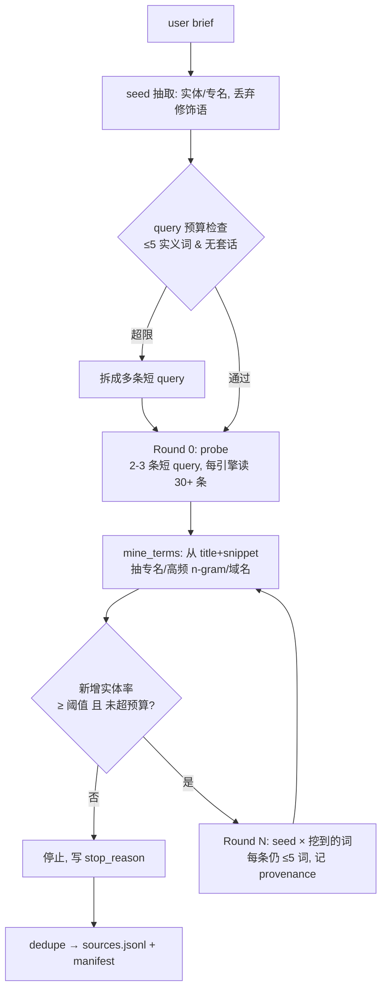

# PRD：Deep Research 渐进式搜索改造

> 状态：草案 v0.1
> 日期：2026-08-29
> 读者：人（对齐）+ coding agent（执行）
> 形态：Executable Spec Pack 精简版 — 单文件
> 改造对象：本仓库

---

## 0. One-liner

把 Deep Research 从「一次性把长 query 扇出到多个搜索面」改成「先用短 query 广撒网 → 从**返回结果**里挖出真实词汇 → 用挖到的词做下一轮更精准的搜索」的多轮渐进式检索，使每条 round≥1 的查询词都能溯源到已检索文档。

**Done when：**

1. `manifest.json` 中存在 ≥2 个 round，且 round≥1 的查询含 round 0 结果中挖出、而 seed 中不存在的词。
2. 任一提交给搜索引擎的查询，其实义词数 ≤ `MAX_QUERY_TERMS`（默认 5），且不含任何方法论套话（"candidate products and projects" 之类）。
3. `coverage.entities` 来自被检索文档正文，不再等于 planner 的硬编码标签。

---

## 1. Context（极短）

| | |
|---|---|
| **问题** | 当前把「整段研究简报 + 一串英文方法论套话」拼成一条 query 打给所有引擎。Google/Reddit 近似 AND 语义，长 query 召回坍塌；且套话词不出现在任何目标文档里，属于负向噪声。 |
| **用户** | 本机所有走 `/deep-research`、`deep-research-product`、`stock-deep-research` 的 agent 与用户本人 |
| **为何现在** | 已有真实产出被污染，见 §8 实测证据 |

---

## 2. Scope

### In（P0 必须）

- **F1** 查询预算：所有引擎统一实义词上限 + 套话黑名单
- **F2** 词汇挖掘：从 SERP 标题/摘要中抽取候选扩展词（含中文），带来源溯源
- **F3** 多轮循环：`round 0 probe → mine → round N expand`，取代当前的一次性 `ThreadPoolExecutor` 扇出
- **F4** 停止门：连续两轮新增实体率 < 阈值即停；写入 manifest
- **F5** 实体统计修正：`coverage.entities` 改为从语料抽取
- **F6** 单轮读广：提高每引擎结果条数上限 + 翻页

### In（P1 有空再做）

- **F7** 模型介入选词（在确定性挖词之上加一个可选的 LLM 重排 hook）
- **F8** 正文抓取（当前仅 snippet，≤800 字符）

### Non-goals（明确不做）

- 不改 Feishu 发布链路（`publish_feishu.py` 原样保留）
- 不改 GPTR 合成层（`deep_research.py` 的 synthesis 段落）
- 不引入 embedding / 向量检索依赖（`breadth.py` 现有「无网络无模型依赖」特性必须保住，否则 fixture 回归测试失效）
- 不做跨 run 的持久化知识库
- 本轮不动 `last30days` 内部实现，只按 F1 约束传入的 query

---

## 3. Constraints

| 类型 | 内容 |
|------|------|
| **Stack** | Python 3.11，标准库 only（现有 `breadth.py` 零依赖，必须保持）；Node 侧仅 `cdp_browser_daemon.js` 调用不变 |
| **集成** | `smart-search` CLI、Tavily HTTP、CDP Chrome（google/reddit/x/sogou-weixin）、`last30days.py` |
| **性能** | 多轮串行会拉长墙钟时间。约束：`--rounds` 默认 2，同轮内并发保持 ≤4 worker；单 run 总 query 数 ≤ `max_queries`（默认 12），超出即停 |
| **命令** | 测试：`python3 -m unittest discover -s tests -v` · 离线回归：`python3 scripts/evaluate_breadth.py`（需扩展，见 F4 AC3） |

---

## 4. Main flow



文字步骤（含失败）：

1. 从 brief 抽 seed 实体（专名、引号短语、CJK 实词串），**不**整段拼接 → 抽不出时退化为 brief 前 N 词并标 `degraded=true`
2. Round 0：每条 seed query 打全部启用的 plane，每引擎取 30 条（当前 12）
3. 挖词：对本轮全部 title+snippet 统计候选词，减去 seed 与停用词 → 按频次×文档分散度排序
4. 判停：本轮新增 canonical 实体占比 < 10% 或 query 预算耗尽 → 停，写 `stop_reason`
5. Round N：`seed + 1~2 个挖到的词` 组合成新 query；每个新 query 记录 `provenance.term` 与 `provenance.source_url`
6. 任一 plane 失败：记 `source_health`，不阻断其他 plane（保持现有行为）

---

## 5. Features

### F1. 查询预算与套话黑名单 · P0

**行为：** 提交给任何引擎前，query 必须通过 `enforce_query_budget()`：实义词 ≤ `MAX_QUERY_TERMS`（默认 5，CJK 连续实词串计 1 词），且不含方法论套话。

**Acceptance criteria：**

1. Given `MAX_QUERY_TERMS=5`，When 调用 `enforce_query_budget("ByteDance departments 红果短剧 懂车帝 org chart sub departments category definitions and alternatives taxonomy")`，Then 返回长度 ≤5 实义词的 query，且不含 `category definitions`/`alternatives`/`taxonomy` 任一套话词。
2. Given 任一 `STOPWORD_PHRASES` 中的短语，When 出现在待发查询里，Then 被剥离；若剥离后为空，Then 抛 `ValueError` 而非发出空查询。
3. Given `browser_search.compress_query_for_site`，When site 为 `google` 或 `reddit`，Then 同样受词数上限约束（现状：仅 `sogou-weixin`/`x` 截断，google/reddit 无上限 — 必须修掉）。
4. Given 全量 12 个 dimension 标签，When 跑 `test_no_methodology_vocab_in_queries`，Then 生成的所有 query 均不含 `specs` 表里的 topic/label 文本。

**数据：**

```text
STOPWORD_PHRASES: list[str]   # "candidate products and projects", "category definitions and alternatives", ...
MAX_QUERY_TERMS: int = 5
```

---

### F2. 结果词汇挖掘 · P0

**行为：** 新增 `mine_terms(items, seed_terms) -> list[MinedTerm]`，从已检索条目的 title+snippet 抽候选扩展词。纯确定性，无网络无模型。

**Acceptance criteria：**

1. Given 一组含 `title`/`snippet` 的 items，When 调用 `mine_terms`，Then 每个返回项含 `{term, freq, doc_freq, sample_url}`，且 `sample_url` 是真实出现过该词的条目 URL。
2. Given seed 词已在 `seed_terms` 中，When 挖词，Then 该词不出现在返回列表（避免自我回声）。
3. Given 中英混合语料，When 挖词，Then 能抽出 CJK 专名串（≥2 字）与 Latin 专名（含 `-`/`.`/数字，如 `RISC-V`、`gpt-4o`）。
4. Given 空 items，When 挖词，Then 返回 `[]` 且不抛异常。
5. Given fixture `tests/fixtures/*.jsonl`，When 跑挖词，Then top-10 结果中至少 3 个是语料内真实出现的专名（fixture 内以 `expect_mined: true` 标注）。

---

### F3. 多轮渐进循环 · P0

**行为：** 新增 `scripts/progressive.py`，以 round 为单位驱动检索；`multi_source_search.py` 改为调用它，取代现有「一次性 map 所有 family」。

**Acceptance criteria：**

1. Given `--rounds 2`，When 完成一次 run，Then `manifest.json` 含 `rounds: [...]`，每个 round 有 `round_index`、`queries`、`new_urls`、`new_entities`、`mined_terms`。
2. Given round 0 完成且挖到 ≥1 个新词，When 构造 round 1 查询，Then **至少一条** round 1 query 含 round 0 结果中出现、而 seed 中不存在的词。
3. Given round≥1 的任一 query，When 读 manifest，Then 其 `provenance` 字段非空且 `provenance.source_url` 存在于上一轮 `sources.jsonl`。
4. Given `--rounds 1`，When 运行，Then 行为等价于当前单轮（向后兼容逃生阀）。
5. Given 某 plane 在 round 0 全失败，When 进入 round 1，Then 仍用其余 plane 的结果挖词，不中断。

---

### F4. 停止门与真实覆盖度 · P0

**行为：** 把 `build_research_profile` 里现有但**从未被读取**的 `stopping` 配置接上实际控制流。

**Acceptance criteria：**

1. Given 连续两轮新增 canonical 实体率 < `two_round_new_entity_rate_below`（0.10），When 循环判停，Then 停止并写 `stop_reason: "entity_saturation"`。
2. Given 累计 query 数达到 `max_queries`，When 判停，Then 停止并写 `stop_reason: "query_budget"`。
3. Given `grep -rn "max_branch_depth\|two_round_new" scripts/`，When 改造完成，Then 这些 key 在**定义之外**至少各有一处读取点（当前为 0，纯死配置）。
4. Given `family_coverage` 指标，When 计算，Then 分母不再仅取自 planner 自身的计划（自评分），需在 `COVERAGE.md` 中同时给出「计划内覆盖」与「新发现实体数」两个独立数字。

---

### F5. 实体来源修正 · P0

**行为：** `annotate_items` 当前把 planner 的硬编码标签写进 `entities`，导致 `coverage.entities` 恒等于 dimension 标签。改为：`entities` 只接受来自语料抽取的词；planner 标签移至 `dimension_label` 字段。

**Acceptance criteria：**

1. Given 一次真实 run，When 读 `manifest.coverage.entities`，Then 其中不含 `products`/`taxonomy`/`workflows`/`mechanisms`/`community`/`repositories` 这组 planner 标签（除非语料里真的出现）。
2. Given 现有测试 `test_metrics_count_family_ids_preserved_after_dedupe`，When 改造后运行，Then 仍通过（或同步更新断言并说明原因）。
3. Given `annotate_items`，When 传入 family，Then `dimension_label` 保留原标签供调试，`entities` 默认为 `[]`。

---

### F6. 单轮读广 · P0

**行为：** 提高每引擎结果上限，让「一次看很多结果再挖词」成为可能。

**Acceptance criteria：**

1. Given `browser_search.py` 各 `*_JS`，When 改造完成，Then `out.slice(0, N)` 的 N 可由 `--max-results-per-site` 配置，默认 30（当前硬编码 12/12/12/15）。
2. Given Google plane，When `--pages 2`，Then 抓取 `&start=0` 与 `&start=10` 两页并合并去重。
3. Given `gptr-docs/sources.md`，When 生成，Then 条数上限可配置（当前硬编码 `fused[:40]`），默认 ≥80。

---

## 6. Boundaries

- **Always：** 改动后跑 `python3 -m unittest discover -s tests`；保持 `breadth.py` 零第三方依赖；每个 AC 对应一条可执行断言后才标 done。
- **Ask first：** 改 `manifest.json` 已有字段的语义（下游 `deep-research-product` / `stock-deep-research` 可能依赖）；改默认 `--width`；改 CDP lane 名。
- **Never：** 动 `publish_feishu.py` 与飞书发布门；删用户 GPTR `.env`；为了让指标好看而把 `stop_reason` 默认设成饱和；把 `--rounds` 默认调到 >3（墙钟成本）。

---

## 7. Open questions

- [NEEDS CLARIFICATION: 挖词的选词环节是否要让模型介入？确定性挖词可回归测试但选词质量有限；LLM 选词更聪明但破坏 `evaluate_breadth.py` 的可复现对比。建议 P0 先做确定性，留 `--term-selector llm` hook 到 P1。]
- [NEEDS CLARIFICATION: `--rounds` 默认值 2 还是 3？2 轮墙钟约为现状 2 倍，3 轮 3 倍。]
- Assumption：`--width` 语义保留但降级为「每轮并行 seed 条数」，不再是「12 个固定 dimension 拼词」。现有 `specs` 表转为**面向 plane 的检索策略提示**（决定打哪个站点），而非拼进 query 字符串。
- Assumption：改造后 SKILL.md 的 `--width wide` 用法仍可用，不需要同步改所有调用方文档；但 §「Agent workflow」里「Never pass a long research brief unchanged to every search plane」这条 prose 规则将由 F1 用代码强制执行。

---

## 8. Gaps vs current code（实测证据）

**已有：**

- `references/unknown-entity-discovery.md` 里的方法论**完全正确**：短查询、单意图、brand-blind、滚雪球、连续两轮 <10% 新实体才算收敛。问题是它 100% 是写给 agent 看的散文，代码零执行。
- `breadth.py` 的 `coverage_metrics` 骨架可复用。
- `browser_search.py::_short_query` 已有截断能力，只是没用在 google/reddit 上。

**缺失 / 不一致：**

1. **查询构造**（`breadth.py:126`）：`f"{clean} {topic} {label}"` — 整段 brief + 英文方法论套话。实测产物：
   `ByteDance departments list 红果短剧 懂车帝 Hong Guo Dongche Di org chart sub departments category definitions and alternatives taxonomy`（18 词）。没有任何目标网页包含 "category definitions and alternatives taxonomy"。
2. **无第二轮**：`multi_source_search.py:665-693` 是一次性 `ThreadPoolExecutor` 扇出，`dedupe` 后直接出报告。`build_research_profile` 写出的 `depth.max_branch_depth` 与整个 `stopping` dict（`breadth.py:167-173`）**被 grep 证实除定义外零读取点** — 死配置。所谓 `--depth fast|standard|deep` 只是写进 manifest 的标签，不产生任何行为差异。
3. **不读结果**：全代码库无正文抓取（grep `readability|fetch_page|full_text` 无命中）；`annotate_items`（`breadth.py:189`）把 planner 标签当实体。实测 `tencent_workbuddy_eco_pm_20260829` run：87 条 URL，`coverage.entities` = `['community','mechanisms','products','repositories','taxonomy','workflows']` —— 正好是 6 个硬编码 family 标签，从 87 篇文档里抽出的实体数为 **0**。
4. **长 query 的实际代价**（同一 run，6 个 family 的 browser plane 产出）：

   | 站点 | 命中 | 是否被强制截断 |
   |---|---:|---|
   | sogou-weixin | 40 | 是（30 字符） |
   | google | 20 | **否** |
   | reddit | **0** | **否** |
   | x | **0** | 是（60 字符）但需登录态 |

   唯一被强制截短的中文面产出最多；完全不截断的 reddit 全军覆没；`q04-mechanism` 整个 browser plane 颗粒无收。这是一次天然实验，与「短 query 召回更好」的判断一致。
5. **指标自评分**：`family_coverage` / `aspect_coverage` 的分母来自 planner 自己的计划，且每个 family 只要 smart-search 有任意命中就算覆盖 → 恒接近 1.0。`evaluate_breadth.py` 的 fixture 标注也出自同一套标签，因此**现有测试无法暴露召回失败**。
6. **taxonomy 与 query 意图脱节**：12 个 dimension 是「产品图谱」taxonomy，被无差别套用。上例是一次**面试准备**查询，系统仍在搜 "repositories, packages, and extensions"。

**本 PRD 以目标行为为准**：query 短、结果多、词从结果里来、轮次真实迭代、指标不自评分。
